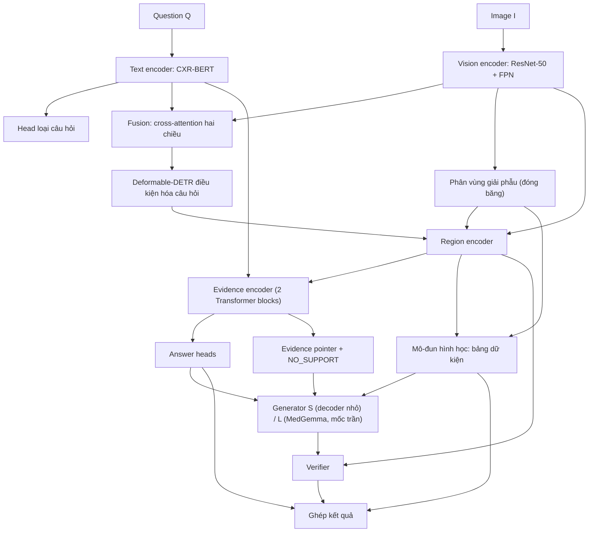

# CV2 — EvidenceKD-MedThink (v4.1)

**Yêu cầu:** mô hình thị giác có kèm lập luận giải thích; kết luận và điểm định lượng do nhánh chuyên biệt sinh; LLM/VLM chỉ tổng hợp lập luận với ràng buộc trích dẫn mã vùng bằng chứng; câu hỏi định hướng vùng quan tâm.

> Kiến trúc giữ nguyên như v4. Phần method được rút gọn; bảng kết quả ghi rõ phương pháp của từng baseline. **[cần kiểm chứng]** = chưa đối chiếu nguồn.

## 1. Ý tưởng và đóng góp

**Tuyên bố.** Chưng cất bằng chứng chọn lọc từ một VLM y khoa cho ra student không gọi VLM khi suy luận, vẫn trả lời, định vị và giải thích bằng mệnh đề có trích dẫn vùng được kiểm chứng.

- **C1 — Chưng cất chọn lọc:** KD-R (relevance phản thực trên vùng) và KD-C (rationale lọc ở mức mệnh đề).
- **C2 — Giải thích khóa đáp án, trích dẫn bắt buộc, faithfulness đo bằng can thiệp lên vùng.**

**Hai hệ thống:** Proposed-S (decoder nhỏ, không gọi VLM, hệ thống chính); Proposed-L (generator MedGemma + LoRA trên cùng nhánh quyết định, mốc trần).

| RQ | Câu hỏi | Metric chính |
|---|---|---|
| 1 | Tách quyết định khỏi diễn giải có giảm mệnh đề không được hỗ trợ so với VLM end-to-end? | Supported-claim precision tại cùng coverage |
| 2 | KD chọn lọc có hơn KD thường, label smoothing, chọn ngẫu nhiên? | Answer & grounding success |
| 3 | S giữ được bao nhiêu chất lượng của L, chi phí bao nhiêu? | Tỉ lệ giữ supported-claim precision; latency |

## 2. Dữ liệu, input, output

**Dữ liệu chính:** VinDr-CXR-VQA ([paper](https://arxiv.org/pdf/2511.00504), [dataset](https://huggingface.co/datasets/Dangindev/VinDR-CXR-VQA)); khoảng 4,4 nghìn ảnh, 17,6 nghìn QA **[cần kiểm chứng]**. Annotation đầy đủ lấy từ VinDr-CXR.

```json
{
  "question": "Where is the Cardiomegaly?",
  "answer": "The Cardiomegaly finding refers to an enlargement of the cardiac silhouette, centrally located in the chest <loc_691_1375_1653_1831>.",
  "reason": "Cardiomegaly is a nonspecific finding often indicative of chronic cardiac stress, such as chronic hypertension, valvular disease, or cardiomyopathy.",
  "type": "Where",
  "difficulty": "Medium",
  "gt_finding": "Cardiomegaly",
  "gt_location": "<loc_691_1375_1653_1831>"
}
```

**Tập ngoài (chỉ đánh giá grounding):** MS-CXR hoặc phần X-quang ngực của SLAKE **[cần kiểm chứng giấy phép, ánh xạ lớp]**.

| Trường | Huấn luyện | Suy luận |
|---|---|---|
| `image` | Input (cạnh dài 1024, giữ tỉ lệ) | **Input** |
| `question` | Input (≤ 48 token) | **Input** |
| `type` | Giám sát head loại câu hỏi | Tự dự đoán |
| `gt_finding` | Giám sát finding; positive cho alignment | Không dùng |
| `gt_location` | Giám sát grounding; positive cho alignment; cổng KD | Không dùng |
| `answer` | Chuẩn hóa bằng luật thành nhãn Yes/No, finding, bên, số đếm | Không dùng |
| `reason` | Nguồn tri thức nền đã duyệt theo finding | Không dùng |
| `difficulty` | Chỉ để phân tích | Không dùng |

**Hai chế độ giám sát, báo cáo riêng:** *QA-only* (chỉ các trường QA); *QA+Full* (thêm annotation đầy đủ và mask giải phẫu; cấu hình chính).

**Output:**

```json
{
  "question_type": "Is_there",
  "answer": "Yes",
  "finding": ["Cardiomegaly"],
  "scores": {"answer": 0.88, "detector": 0.81, "verifier": 0.92},
  "regions": [
    {"id": "R01", "kind": "finding", "label": "Cardiomegaly", "bbox": [691, 1375, 1653, 1831]},
    {"id": "A_thorax", "kind": "anatomy", "bbox": [210, 300, 2100, 2000]}
  ],
  "facts": [{"id": "F3", "attr": "ctr", "value": 0.58, "evidence_ids": ["R01", "A_thorax"]}],
  "claims": [
    {"type": "observation", "text": "The cardiac silhouette is enlarged.", "fact_ids": ["F3"], "evidence_ids": ["R01", "A_thorax"], "status": "supported"},
    {"type": "background", "text": "Cardiomegaly is often associated with chronic hypertension."}
  ]
}
```

Đáp án, finding và điểm do nhánh quyết định sinh; generator không được sửa. Mệnh đề `observation` bắt buộc trích vùng và qua verifier; `background` lấy từ danh sách đã duyệt, không tính vào chỉ số bằng chứng.

**Tiền xử lý:** kiểm tra nhất quán answer–finding–bbox; dựng lại nhãn đếm từ annotation đầy đủ; chia theo ảnh; ảnh validation/test không xuất hiện ở tiền huấn luyện detector, tinh chỉnh teacher hay sinh mục tiêu KD. Tập kiểm định giải thích: 800–1000 mệnh đề, hai bác sĩ chấm mù, báo cáo kappa.

## 3. Kiến trúc



| Khối | Cấu hình chính | Đối chiếu |
|---|---|---|
| Vision encoder | ResNet-50 + FPN (4 mức, d=256), tiền huấn luyện detection trên VinDr-CXR | Không tiền huấn luyện |
| Text encoder | microsoft/BiomedVLP-CXR-BERT-specialized, chiếu về d=256 | PubMedBERT |
| Fusion | 2 lớp cross-attention hai chiều, 8 heads | Nối đặc trưng |
| Detector | Deformable-DETR, 6+6 lớp, 100 queries điều kiện hóa câu hỏi; head finding toàn ảnh không điều kiện | Không điều kiện |
| Giải phẫu | Mô hình phân vùng phổi/tim có sẵn, đóng băng | Không có |
| Region encoder | ROIAlign 7×7 trên vùng gốc và vùng mở rộng ×1,5; embedding tọa độ, lớp; token toàn ảnh | Chỉ ROI gốc |
| Evidence encoder | 2 Transformer blocks trên tập vùng và token câu hỏi | — |
| Answer heads | Yes/No, finding đa nhãn, bên, đếm | Answer-only |
| Mô-đun hình học | Luật tính dữ kiện từ hộp và mask | Chỉ presence + vị trí |
| Generator S | Decoder cỡ T5-base + visual adapter, giải mã ràng buộc | Không KD |
| Generator L | google/medgemma-4b-it + LoRA (r=16), cùng ràng buộc | Mốc trần |
| Verifier | Encoder văn bản riêng + cross-attention ROI + head 3 trạng thái | Không verifier |
| Teacher | MedGemma tinh chỉnh riêng, đóng băng, không chung trọng số với generator L | Tổ hợp detector (dự phòng cho KD-R) |

## 4. Phương pháp

### 4.1. Nhánh quyết định

Câu hỏi được trộn vào ảnh rồi điều kiện hóa object query của detector:

\[
\widetilde H_I=H_I+\mathrm{CA}(H_I,H_Q,H_Q),\quad
\widetilde H_Q=H_Q+\mathrm{CA}(H_Q,\widetilde H_I,\widetilde H_I),\quad
u_j^Q=u_j+W_q\,\mathrm{Pool}(\widetilde H_Q)
\]

Head relevance \(\hat\rho_j\) chọn hộp là vùng mục tiêu của câu hỏi. Alignment kéo câu hỏi về vùng hỗ trợ; negative phải được xác định là không hỗ trợ:

\[
L_{align}=-\log\frac{\sum_{i\in P_Q}\exp(s(q,z_i)/\tau)}{\sum_{i\in P_Q\cup N_Q}\exp(s(q,z_i)/\tau)}
\]

Answer heads (Yes/No, finding, bên, đếm) đọc biểu diễn vùng \(h_i\) qua attention. Đáp án âm tính dựa trên head Yes/No và head finding toàn ảnh, không dựa trên việc thiếu hộp.

### 4.2. Bảng dữ kiện bằng chứng

Tính bằng hình học từ hộp và mask, không qua mô hình ngôn ngữ.

| Thuộc tính | Cách tính | Vùng trích |
|---|---|---|
| Có mặt | Hộp lớp \(c\) vượt ngưỡng | Hộp |
| Bên | Tâm hộp so với đường giữa lồng ngực | Hộp, `A_thorax` |
| Tầng phổi | Tầng trên/giữa/dưới chứa tâm hộp | Hộp, phổi cùng bên |
| Một/hai bên | Phân bố các hộp cùng lớp | Các hộp cùng lớp |
| Số lượng | Số hộp cùng lớp sau NMS | Các hộp cùng lớp |
| Mức lan rộng | Diện tích hộp trong phổi / diện tích phổi, 3 mức | Hộp, phổi cùng bên |
| CTR | Bề ngang tim / bề ngang lồng ngực; chỉ báo cáo trên phim PA | `A_heart`, `A_thorax` |
| Đồng xuất hiện | Cặp finding cùng có mặt | Các hộp liên quan |
| Vắng mặt | Không có hộp vượt ngưỡng và head toàn ảnh dưới ngưỡng | Vùng giải phẫu tương ứng |

### 4.3. Pointer, generator, verifier

Pointer chọn dữ kiện và vùng liên quan đến câu hỏi, có lựa chọn `NO_SUPPORT`:

\[
\pi^S_c(i)=\frac{\exp(e_c^\top W_ph_i)}{\exp(e_c^\top w_\varnothing)+\sum_j\exp(e_c^\top W_ph_j)},\qquad
L_{pointer}=-\sum_c\log\sum_{i\in G_c}\pi^S_c(i)+\lambda_f\,\mathrm{KL}\big(\pi^{cf}\Vert\pi^S_{c_0}\big)
\]

Số hạng thứ hai là ràng buộc faithfulness: \(\pi^{cf}\) là softmax của mức sụt xác suất đáp án của chính nhánh quyết định khi che từng vùng,

\[
r^{cf}_i=\max\!\big(0,\ \log p_S(\hat a\mid I,Q)-\log p_S(\hat a\mid I_{\setminus i},Q)\big)
\]

Generator nhận câu hỏi, đáp án đã khóa và dữ kiện được chọn; sinh mệnh đề theo định dạng `<obs facts=F1> text [R01] </obs>`. Giải mã ràng buộc: token trích dẫn chỉ lấy từ ID vùng của dữ kiện đã khai báo; mệnh đề quan sát không đóng được nếu chưa trích dẫn.

Verifier dự đoán supported / contradicted / insufficient. Mẫu dương tính từ annotation; mẫu âm tổng hợp bằng đổi finding, đổi bên, tráo vùng, che vùng. Verifier là thành phần hệ thống; chất lượng giải thích được chấm bằng bác sĩ và một bộ kiểm chứng độc lập.

### 4.4. Chưng cất chọn lọc

**KD-R.** Teacher chỉ thấy ảnh và câu hỏi; che từng vùng và đo mức sụt xác suất đáp án đúng:

\[
r^T_i=\max\!\big(0,\ \log p_T(a^\*\mid I,Q)-\log p_T(a^\*\mid I_{\setminus i},Q)\big),\qquad
\pi^T=\mathrm{softmax}\big([r^T_1..r^T_M,\ r_\varnothing]/\tau_T\big)
\]

\[
L_{KD\text{-}R}=\frac{\sum_nw_n\,\mathrm{KL}(\pi^T_n\Vert\pi^S_{n,c_0})}{\sum_nw_n+\epsilon},\qquad
w_n=\mathbb 1[\hat a^T_n=a^\*_n]\cdot\mathbb 1[m_n\ge\delta]\cdot c_n
\]

\(m_n\) là khối lượng teacher đặt trên vùng mục tiêu, \(c_n\) là độ tin cậy đã hiệu chỉnh. Annotation chỉ dùng ở cổng. Phần khối lượng trên vùng phụ là tri thức được truyền.

**KD-C.** Teacher nhận bảng dữ kiện tính từ annotation, sinh 3 rationale. Mỗi mệnh đề quan sát phải khớp dữ kiện, trích đúng vùng và qua verifier; chỉ mệnh đề đạt mới là mục tiêu của generator S:

\[
L_{KD\text{-}C}=-\sum_{c\in\mathcal C_{pass}}\sum_t\log p_S\big(y_{c,t}\mid y_{c,<t},Q,a,\mathcal F_{sel},\{h_i\}\big)
\]

### 4.5. Huấn luyện

| Giai đoạn | Học | Loss |
|---|---|---|
| 0 | Detector | \(L_{det}\) |
| 1 | Fusion, evidence encoder, answer heads | \(L_{det}+L_{rel}+\lambda_aL_{answer}+\lambda_cL_{align}\) |
| 2 | Thêm pointer và KD-R | \(+\lambda_pL_{pointer}+\lambda_kL_{KD\text{-}R}\) |
| 3 | Verifier; generator L rồi S (nhánh quyết định đóng băng) | \(L_{verify}\); \(L_{text}\); \(L_{KD\text{-}C}\) |

Suy luận Proposed-S: mã hóa → detector và vùng giải phẫu → đáp án → bảng dữ kiện → pointer → generator → verifier → JSON. Không gọi VLM.

## 5. So sánh

**Quy tắc:** cùng split và tiền xử lý; so sánh trong cùng chế độ giám sát; đầu ra văn bản của baseline parse bằng cùng bộ luật chuẩn hóa; đầu ra không hỗ trợ ghi N/A, không gán 0; giải thích so tại cùng coverage.

| Câu hỏi cần trả lời | So sánh | Metric chính | Bảng |
|---|---|---|---|
| Dataset thiên lệch ngôn ngữ đến đâu? | B1 với mọi mô hình có ảnh | Yes/No F1 | A |
| Có hơn VLM end-to-end? | Proposed với B4, cùng chế độ | Answer & grounding success | A, B |
| Câu hỏi có giúp định vị? | Proposed với B7 | Grounding@IoU 0.5 | B |
| Giải thích có đáng tin hơn? | Proposed với B4, B10 | Supported-claim precision | C |
| Generator có hơn mẫu câu? | Proposed với B8, B9 | Question relevance; độ gọn | C |
| KD chọn lọc có tác dụng? | Các dòng Bảng E | Answer & grounding success | E |
| Vùng trích có là vùng mô hình dùng? | Che vùng trích với bốn đối chứng | Tỉ lệ đổi đáp án | F |
| S có thay được L? | Proposed-S với Proposed-L | Tỉ lệ giữ chất lượng; latency | C, F |
| Có giữ được ngoài VinDr? | Proposed với B4 trên tập ngoài | Grounding@IoU 0.5 | B |

**Thứ tự chạy:** B1 → detector (giai đoạn 0) và B2 → B4 → giai đoạn 1 + B7, B8, B9 → kiểm tra teacher → KD-R → verifier, generator, KD-C → B5, B6, tập ngoài.

## 6. Metrics

| Nhóm | Metric | Định nghĩa ngắn |
|---|---|---|
| VQA | Yes/No F1; finding macro-F1; side accuracy; count MAE; overall accuracy | Theo loại câu hỏi; đếm trên subset nhãn hợp lệ |
| Định vị | mAP@[.5:.95] | Class-aware, one-to-one; chỉ ở QA+Full |
| | Grounding@IoU 0.5; mIoU | Hộp trả lời so với `gt_location` |
| | **Answer & grounding success** | Đúng đáp án và IoU ≥ 0,5 |
| Giải thích (bác sĩ chấm) | **Supported-claim precision** | Mệnh đề supported / mệnh đề quan sát xuất ra |
| | Citation precision, recall | Cặp (mệnh đề, vùng) đúng / được trích; vùng hỗ trợ được trích / theo nhãn |
| | Coverage; contradiction rate | Mẫu còn ít nhất một mệnh đề; mệnh đề bị chấm mâu thuẫn |
| | Question relevance; độ gọn | Mệnh đề liên quan trực tiếp câu hỏi; số mệnh đề mỗi mẫu |
| Faithfulness | Tỉ lệ đổi đáp án khi che vùng được trích | So với che ngẫu nhiên, che vùng điểm cao không được trích, che vùng top-attention, ghép vùng từ ảnh khác |
| Tin cậy | Verifier macro-F1, false acceptance; ECE, AURC | Verifier chấm trên nhãn bác sĩ |
| KD, chi phí | Teacher pointing accuracy; khối lượng ngoài mục tiêu; tỉ lệ giữ; latency, VRAM | Batch 1, cùng phần cứng |

Ba seed; khoảng tin cậy bootstrap theo ảnh; hiệu chỉnh Holm trên metric chính.

## 7. Kết quả cần điền

**Bảng A — VQA**

| Model | Phương pháp | Chế độ | Yes/No F1 ↑ | Finding macro-F1 ↑ | Side acc ↑ | Count MAE ↓ | Overall ↑ |
|---|---|---|---|---|---|---|---|
| B1 Chỉ-câu-hỏi | CXR-BERT + answer heads, không ảnh | QA-only | — | — | — | — | — |
| B2 Chỉ-ảnh | Detector + luật suy đáp án từ finding dự đoán và tên finding trong câu hỏi | QA+Full | — | — | — | — | — |
| B3 MedGemma zero-shot | Prompt yêu cầu answer + `<loc>` + reason, không tinh chỉnh | — | — | — | — | — | — |
| B4 MedGemma FT | LoRA; sinh answer + `<loc>` + giải thích trong một lượt | QA-only | — | — | — | — | — |
| B4 MedGemma FT | Như trên, thêm nhiệm vụ liệt kê mọi finding kèm `<loc>` | QA+Full | — | — | — | — | — |
| B5 MedThink | Code gốc; sinh answer + reason, không có vùng | QA-only | — | — | — | — | — |
| B6 LobA adapted | Code gốc; mask chuyển thành hộp bao | QA-only | — | — | — | — | — |
| Proposed | Nhánh quyết định đầy đủ, có KD-R | QA-only | — | — | — | — | — |
| Proposed | Nhánh quyết định đầy đủ, có KD-R | QA+Full | — | — | — | — | — |

**Bảng B — Định vị**

| Model | Phương pháp | Chế độ | mAP .5:.95 ↑ | Grounding@.5 ↑ | mIoU ↑ | Answer & grounding ↑ | Grounding@.5 tập ngoài ↑ |
|---|---|---|---|---|---|---|---|
| B4 MedGemma FT | Hộp parse từ token `<loc>` | QA-only | N/A | — | — | — | — |
| B4 MedGemma FT | Hộp parse từ token `<loc>` | QA+Full | — | — | — | — | — |
| B6 LobA adapted | Mask → hộp bao | QA-only | N/A | — | — | — | N/A |
| B7 Không điều kiện \(Q\) | Đề xuất, bỏ fusion và \(W_q\); chọn hộp theo tên finding trong câu hỏi | QA+Full | — | — | — | — | — |
| Proposed | Detector điều kiện hóa câu hỏi + head relevance | QA-only | N/A | — | — | — | — |
| Proposed | Detector điều kiện hóa câu hỏi + head relevance | QA+Full | — | — | — | — | — |

**Bảng C — Giải thích** (QA+Full, cùng coverage)

| Model | Phương pháp | Supported-claim P ↑ | Citation P ↑ | Citation R ↑ | Coverage ↑ | Contradiction ↓ | Question relevance ↑ | Độ gọn |
|---|---|---|---|---|---|---|---|---|
| B4 MedGemma FT | VLM tự sinh giải thích và tự trích hộp | — | — | — | — | — | — | — |
| B5 MedThink | Sinh reason tự do, không trích vùng | — | N/A | N/A | — | — | — | — |
| B8 Mẫu câu đơn giản | Nhánh quyết định của đề xuất; một mệnh đề có mặt + vị trí theo mẫu | — | — | — | — | — | — | — |
| B9 Mẫu câu đầy đủ | Nhánh quyết định của đề xuất; diễn đạt mọi dữ kiện theo mẫu cố định | — | — | — | — | — | — | — |
| B10 Không ràng buộc | Generator L nhận mọi vùng; không pointer, không ràng buộc trích dẫn, không verifier | — | — | — | — | — | — | — |
| Proposed-L | Pointer + MedGemma có ràng buộc + verifier | — | — | — | — | — | — | — |
| Proposed-S | Pointer + decoder nhỏ (KD-C) + verifier | — | — | — | — | — | — | — |

**Bảng D — Ablation kiến trúc** (cùng encoder, detector, generator)

| Variant | Answer & grounding ↑ | Grounding@.5 ↑ | Supported-claim P ↑ | Coverage | Latency ↓ |
|---|---|---|---|---|---|
| Nối đặc trưng | — | — | — | — | — |
| + cross-attention hai chiều | — | — | — | — | — |
| + query điều kiện hóa câu hỏi | — | — | — | — | — |
| + contrastive alignment | — | — | — | — | — |
| + vùng giải phẫu và bảng dữ kiện đầy đủ | — | — | — | — | — |
| + pointer học (thay pointer bằng luật) | — | — | — | — | — |
| + ràng buộc faithfulness | — | — | — | — | — |
| + giải mã ràng buộc | — | — | — | — | — |
| + verifier | — | — | — | — | — |

**Bảng E — Ablation chưng cất** (cùng student, cùng lịch huấn luyện)

| Variant | Phương pháp | Tỉ lệ giữ | Grounding@.5 ↑ | Answer & grounding ↑ | Supported-claim P ↑ |
|---|---|---|---|---|---|
| Không KD | Chỉ nhãn | — | — | — | — |
| Answer KD | KL trên phân phối đáp án của teacher | — | — | — | — |
| Label smoothing | Nhãn vùng làm mềm, entropy bằng \(\pi^T\) | — | — | — | — |
| KD-R không chọn lọc | \(w_n=1\) | 100% | — | — | — |
| KD-R chọn ngẫu nhiên | Giữ ngẫu nhiên cùng tỉ lệ với cổng | — | — | — | — |
| KD-R chỉ theo \(c_n\) | Lọc theo độ tin cậy | — | — | — | — |
| KD-R chỉ theo \(m_n\) | Lọc theo khối lượng trên vùng mục tiêu | — | — | — | — |
| **KD-R chọn lọc** | Cổng đầy đủ | — | — | — | — |
| KD-R, teacher tổ hợp detector | Relevance từ điểm trung bình của 3 detector | — | — | — | — |
| S không KD | Generator S học từ mẫu câu B9 | N/A | N/A | N/A | — |
| S + KD-C không lọc | Mọi mệnh đề của teacher | 100% | N/A | N/A | — |
| S + KD-C mức mẫu | Bỏ cả rationale nếu có mệnh đề hỏng | — | N/A | N/A | — |
| **S + KD-C mức mệnh đề** | Giữ từng mệnh đề đạt | — | N/A | N/A | — |

**Bảng F — Tin cậy, faithfulness và chi phí**

| Model | ECE ↓ | AURC ↓ | Verifier F1 ↑ | False accept ↓ | Đổi đáp án: che vùng trích ↑ | Đổi đáp án: đối chứng mạnh nhất ↓ | Latency ↓ | VRAM ↓ |
|---|---|---|---|---|---|---|---|---|
| B4 MedGemma FT | — | — | N/A | N/A | — | — | — | — |
| Proposed-L | — | — | — | — | — | — | — | — |
| Proposed-S | — | — | — | — | — | — | — | — |

## 8. Tiêu chí thành công và điểm dừng

| Thời điểm | Tiêu chí | Nếu không đạt |
|---|---|---|
| Sau B1 | Mô hình có ảnh vượt rõ B1 trên Yes/No | Báo cáo chính dùng grounding và answer & grounding, không dùng accuracy |
| Sau giai đoạn 0 | mAP detector hợp lý trên VinDr-CXR | Sửa detector trước mọi thứ khác |
| Sau giai đoạn 1 | Vượt B4 về answer & grounding, cùng chế độ; grounding ≥ B7 | Chưa làm KD; xem lại fusion và điều kiện hóa |
| Trước KD-R | Teacher nhạy với che vùng; khối lượng ngoài vùng mục tiêu khác 0 | Đổi teacher KD-R sang tổ hợp detector; nếu vẫn không, bỏ KD-R khỏi đóng góp |
| Sau KD-R | KD-R chọn lọc vượt mọi dòng đối chứng ở Bảng E | Báo cáo kết quả âm; C1 chỉ còn KD-C |
| Sau generator | Vượt B4 về supported-claim precision tại cùng coverage | Kiểm tra verifier và ngưỡng; báo cáo trung thực |
| Sau generator | Hơn B9 về question relevance và độ gọn | Xuất dữ kiện có cấu trúc; không tuyên bố về lập luận |
| Sau KD-C | S giữ phần lớn supported-claim precision của L, latency thấp hơn nhiều | Proposed-L là hệ thống chính |
| Cuối | Che vùng trích đổi đáp án nhiều hơn cả bốn đối chứng | Không tuyên bố faithfulness |
| Cuối | Thứ hạng grounding so với B4 giữ trên tập ngoài | Nêu trong hạn chế |

Ngưỡng số cụ thể được chốt trước khi mở test. Nguyên tắc chung: không đạt thì giảm thành phần và báo cáo kết quả âm, không thêm kỹ thuật.

## 9. Hạn chế

QA do LLM sinh; câu hỏi lộ tên finding; một nguồn bệnh viện; mệnh đề chỉ phủ thuộc tính hình học; CTR phụ thuộc tư thế chụp và mô hình phân vùng; chế độ QA+Full dùng annotation mà QA-only không có.

## 10. Tài liệu nền

[MedThink](https://aclanthology.org/2025.findings-naacl.415/) ([code](https://github.com/Tang-xiaoxiao/Medthink)) · [LobA](https://www.ijcai.org/proceedings/2025/853) · [Phrase-grounded Fact-checking](https://papers.miccai.org/miccai-2025/0693-Paper3526.html) · [VinDr-CXR-VQA](https://arxiv.org/abs/2511.00504) · [CoMed-TR](https://doi.org/10.1016/j.imavis.2025.105820) (related work)
