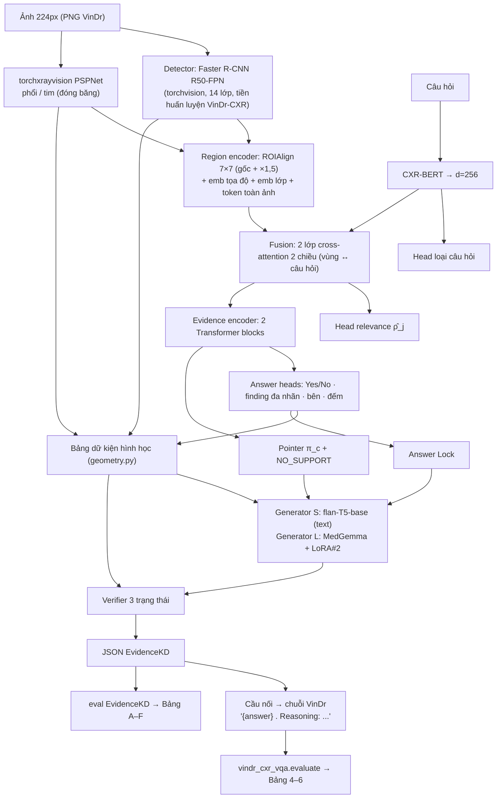

# Thiết kế: VinDr-CXR-VQA chạy theo luồng EvidenceKD-MedThink v4.1

**Ngày:** 2026-10-26
**Repo đích:** `EvidenceKD-MedVQA` (repo này)
**Repo nguồn:** `../VinDR-CXR-VQA` — bản tái lập arXiv:2511.00504v2, đã có dataset dựng sẵn, recipe huấn luyện MedGemma + LoRA, scorer Bảng 4–6, UI và notebook Kaggle.
**Đọc kèm:** `docs/method_spec_v4.1.md` (phương pháp), `docs/implementation_audit.md` (môi trường), `../VinDR-CXR-VQA/docs/DATA_NOTES.md` (dữ liệu thực sự chứa gì).

> Quy ước trong tài liệu: **[VinDr]** = lấy nguyên từ repo VinDR-CXR-VQA; **[Spec]** = theo `method_spec_v4.1.md`; **[Tôi chốt]** = lựa chọn của người viết, anh có thể đổi; **[Anh quyết]** = chỉ anh trả lời được và câu trả lời đổi thứ sẽ được xây.

---

## 0. Tóm tắt

Giữ nguyên **bài toán và ứng dụng** của VinDr-CXR-VQA: hỏi một câu về một ảnh X-quang ngực, nhận câu trả lời nêu bệnh lý, kèm hộp `<loc_...>` và lời giải thích; chấm bằng Bảng 4 (VQA), Bảng 5 (box), Bảng 6 (localization) so với hai dòng Pretrained / Fine-tuned của paper; có UI hỏi từng ảnh; huấn luyện trên Kaggle T4.

Thay **cách sinh ra câu trả lời đó** bằng luồng EvidenceKD: một *nhánh quyết định* (detector + answer heads) chốt đáp án, finding và hộp; một *bảng dữ kiện hình học* tính từ hộp và giải phẫu; một *pointer* chọn vùng bằng chứng (hoặc `NO_SUPPORT`); một *generator* chỉ diễn giải đáp án đã khóa bằng các mệnh đề có trích dẫn mã vùng; một *verifier* chấm từng mệnh đề. MedGemma + LoRA (chính mô hình VinDr đã fine-tune) đóng ba vai: baseline B4, teacher cho KD-R/KD-C, và generator L (mốc trần).

Đầu ra JSON của EvidenceKD được **dịch ngược** thành chuỗi `"{đáp án} <loc_...>. Reasoning: ..."` để `vindr_cxr_vqa.evaluate` chấm Bảng 4–6 không sửa một dòng — đó là cầu nối giữ mục đích gốc.

---

## 1. Ý định và lý do

VinDr-CXR-VQA cho MedGemma tự sinh cả ba thứ trong một lượt: đáp án, hộp, lời giải thích. Kết quả paper: F1 VQA 0,624 nhưng precision 0,471 (ảo giác finding), box recall 0,090, và lời "reasoning" không ràng buộc gì với hộp nó vẽ. Ba vấn đề đó chính là ba thứ EvidenceKD được thiết kế để tách ra:

| Vấn đề ở VinDr-CXR-VQA | Luồng EvidenceKD xử lý bằng |
|---|---|
| Finding do LM "nói ra", không ai kiểm | Finding do head đa nhãn của nhánh quyết định; LM không được sửa (Answer Lock) |
| Hộp là 12 chữ số LM phát ra; recall 0,09 | Hộp do detector; head relevance chọn hộp trả lời câu hỏi |
| "Reasoning" là văn tự do, không gắn với vùng | Mệnh đề `<obs facts=F3> ... [R01] </obs>` bắt buộc trích vùng, qua verifier; faithfulness đo bằng che vùng |
| 60 % hộp dạy sai cơ quan (DATA_NOTES §1) | Dùng `gt_location_fixed` [VinDr]; gate KD-R chặn mẫu teacher sai |

Mục đích ứng dụng không đổi: một bác sĩ/kỹ sư chọn ảnh, hỏi, thấy hộp đè lên hộp của radiologist, thấy IoU, và *thêm* thấy mỗi câu giải thích chỉ vào vùng nào.

---

## 2. Mục tiêu, không-mục-tiêu, phản-mục-tiêu

**Mục tiêu**
1. Một hệ thống **Proposed-S** (không gọi VLM khi suy luận) và **Proposed-L** (MedGemma + LoRA làm generator) chạy được end-to-end trên dữ liệu VinDr-CXR-VQA, huấn luyện trên Kaggle.
2. Chấm được **Bảng 4–6** của VinDr bằng đúng scorer của repo VinDr, đặt cạnh Pretrained / Fine-tuned của paper và cạnh B4 tái lập.
3. Chấm được các bảng **A, B, E, F** của spec; bảng **C, D** ở mức máy chấm được (xem §9).
4. **UI** của VinDr hoạt động với backend mới, có thêm panel mệnh đề ↔ vùng.
5. Giữ nguyên các quy tắc "không được đảo" của README repo này.

**Không-mục-tiêu (v1)**
- Deformable-DETR điều kiện hóa câu hỏi (spec §3) — thay bằng Faster R-CNN + head relevance, xem §6. Có thể nâng cấp sau.
- Visual adapter cho generator S — v1 generator S chỉ đọc văn bản (bảng dữ kiện đã mã hóa hình học).
- Tập ngoài MS-CXR / SLAKE.
- Chấm bởi bác sĩ 800–1000 mệnh đề — không có trong tầm tay; bảng C báo "máy chấm" cho đến khi có.

**Phản-mục-tiêu** (làm được mà vẫn là thất bại)
- Số liệu Bảng 4–6 không tái chấm được bằng `vindr_cxr_vqa.evaluate` nguyên bản.
- Generator sửa đáp án của nhánh quyết định dù chỉ một lần.
- Ảnh val/test lọt vào tiền huấn luyện detector, teacher hay sinh mục tiêu KD.
- Thay dataset bằng dataset khác hoặc sinh lại câu hỏi — dữ liệu gốc phải giữ nguyên là 17.597 QA pair của bản phát hành.

---

## 3. Ràng buộc

| Loại | Ràng buộc | Nguồn |
|---|---|---|
| Phần cứng | Máy local không có CUDA; Python MSYS2 3.14, không torch. Mọi huấn luyện trên Kaggle T4×2 / P100, ≤ 12 h/phiên, `/kaggle/working` bị xóa | `implementation_audit.md` §2 |
| Ảnh | PNG đã resize **224×224** (toàn bộ 15.000 train + 3.000 test VinDr-CXR có trên đĩa tại `../VinDR-CXR-VQA/dataset/`); tọa độ `gt_location` ở pixel DICOM gốc | DATA_NOTES "Các hệ toạ độ" |
| Dữ liệu | 100 % mẫu dương; `reason` ~18 từ; 60 % hộp công bố sai lớp; test ⊂ val theo paper | DATA_NOTES §1–5 |
| Giấy phép | VinDr-CXR PhysioNet credentialed: không commit, không upload ảnh ra ngoài dataset Kaggle riêng; CXR-BERT giấy phép MSR phải ghi lại | README §Data |
| Quy ước repo | Core torch-free, torch import lazy; notebook Kaggle được **sinh** từ script, không sửa tay; checkpoint + resume qua nhiều phiên; "Decisions that must not be reverted" | README, audit §1.1 |
| Tương thích | Mọi baseline parse bằng `answer_norm.py`; không gán 0 cho metric không đo được, ghi N/A | spec §5 |

---

## 4. Tài sản lấy từ VinDR-CXR-VQA và chỗ dùng

| Tài sản [VinDr] | Đường dẫn | Dùng ở đâu trong EvidenceKD |
|---|---|---|
| Dataset đã dựng: `train/val/test.jsonl`, `images.json`, `build_summary.json` | `data/processed/` | Nguồn dữ liệu duy nhất. Adapter `evidencekd.data.vindr_processed` đọc thẳng, không dựng lại |
| 14 lớp bệnh + synonyms + 6 loại câu hỏi | `vindr_cxr_vqa/constants.py:12-72` | `labels.VQA_CLASSES`; `answer_norm` dùng synonyms để lấy finding từ văn bản baseline |
| Ba hệ tọa độ + `<loc>` parse/format + `match_any`/`greedy_match` | `vindr_cxr_vqa/boxes.py` | Cầu nối định dạng; scorer Bảng 5–6 |
| Hộp đồng thuận `boxes_fused` (IoU 0,3, `votes`) và hộp thô `boxes_raw` | `images.json` | Vùng ứng viên QA+Full (`FusedBox.n_raters = votes`); ground truth Bảng 5 (`raw`) |
| `gt_location_fixed`, `repair_method` | mỗi record | Nhãn relevance (hộp nào trả lời câu hỏi); tập `G_c` cho pointer; cổng KD-R |
| Prompt + target MedGemma, collator, soft-GIoU, LoRA, trainer, infer | `prompts.py`, `data.py`, `losses.py`, `train.py`, `infer.py` | B4 baseline; teacher (teacher-forced logprob); generator L (LoRA thứ hai) |
| Adapter đã train (MedGemma-1.5-4B-it, r=16, 114 MB) | `outputs/medgemma-lora-unzipped/` | Teacher đóng băng và B4 ngay lập tức, không phải train lại |
| Scorer Bảng 4–6, `--oracle`, `results.render`, số của paper | `evaluate.py`, `results.py:21-40` | Chấm Proposed-S/L và mọi baseline trên cùng ba bảng |
| `serve.py` HTTP API + React UI | `serve.py`, `ui/` | Hợp đồng API giữ nguyên, thêm trường `evidence` |
| Notebook sinh từ cell, bundle code/images tách đôi, dò offline, resume | `scripts/notebook_cells.py`, `make_kaggle_bundle.py` | Mẫu cho 5 notebook giai đoạn của EvidenceKD; dataset ảnh trên Kaggle (`tuynnguynee/vpa-repo`) dùng lại, không upload lần nữa |
| `reason` theo từng `gt_finding` | mỗi record | Danh sách mệnh đề `background` đã duyệt (spec §2) — 14 finding × các câu distinct |

**Cách phụ thuộc mã** [Tôi chốt]: không copy `vindr_cxr_vqa` vào `src/`. Local: thêm `../VinDR-CXR-VQA` vào `pythonpath` của pytest và `PYTHONPATH` khi chạy script. Kaggle: bundle code của EvidenceKD copy thêm thư mục `vindr_cxr_vqa/` (package stdlib-only ở phần data/eval) vào cùng zip. Một bản scorer, một bản parser `<loc>`; sửa ở VinDr thì EvidenceKD hưởng.

---

## 5. Dữ liệu và chia tập

### 5.1 Bản ghi

`evidencekd.data.vindr_processed.load_split(processed_dir, split) -> list[VQASample]` đọc JSONL [VinDr]. Mỗi `VQASample` giữ:

- phần QA: `sample_id, image_id, question, answer, reason, type, difficulty, gt_finding` (đúng 7 trường spec §2);
- hộp mục tiêu: `bbox_fixed_orig` (pixel gốc) **là hộp giám sát**; `bbox_orig` (công bố) chỉ để tái lập paper;
- `image_width/height`, `fx/fy` để quy đổi về 224 px khi detector chạy;
- `repair_method`, `box_label_consistent` để phân tích.

`vqa_schema.VQAItem` hiện đọc shape HF (`{image_id, num_questions, vqa:[...]}`). Giữ nguyên nó cho validator; `VQASample` là lớp mới, có `to_item()` để các test cũ vẫn dùng được.

Tọa độ nội bộ của EvidenceKD = **pixel DICOM gốc** (giống `LocBox` và `Box`). Chỉ hai chỗ đổi hệ: (a) detector làm việc ở không gian 224 px rồi `Box.scale(1/fx, 1/fy)` về gốc; (b) cầu nối sang VinDr phát `<loc>` ở `norm1000` bằng `boxes.to_normalized` [VinDr].

### 5.2 Chia tập [Anh chốt: y hệt VinDR-CXR-VQA]

Dùng **chính split của VinDr, cấu hình mặc định** (seed 42, stratify theo lớp hiếm nhất, `disjoint_test: false`), file `data/processed` giống từng byte với repo VinDr:

| Tập | Ảnh | QA | Dùng để |
|---|---|---|---|
| train | 3.735 | 14.960 | mọi huấn luyện, sinh mục tiêu KD |
| val | 659 | 2.637 | Bảng 4–6 đúng như paper chấm; early stop |
| test ⊂ val | 300 | 1.207 | báo cáo held-out, như VinDr |
| "tune" = val ∖ test | 359 | ≈1.430 | **chọn ngưỡng, hiệu chỉnh nhiệt độ teacher** — để vẫn thỏa spec §8 "ngưỡng chốt trước khi mở test" mà không đổi file |

`vindr_processed.ProcessedSplits` đọc split từ `images.json` (`split`, `in_val`); `held_out` = toàn bộ val (chứa test) — không ảnh nào trong đó vào tiền huấn luyện detector, teacher hay sinh KD. Manifest hash ghi `reports/split_manifest.json`. Số liệu được chọn ngưỡng trên "tune" rồi báo trên val-659 (so paper) và test-300.

### 5.3 Gộp hộp [Tôi chốt]

Dùng `boxes_fused` của VinDr (greedy single-link, IoU 0,3, trung bình tọa độ, `votes`) thay vì chạy lại `data/boxes.fuse_boxes` với 0,4. Hai thuật toán giống nhau về bản chất; dùng của VinDr để hộp vùng **trùng khớp với** `gt_location_fixed` (được chọn từ chính tập fused đó). `configs/data.yaml: box_fusion.iou_threshold` → 0,3, ghi lý do. `n_raters = votes` giữ nguyên trên mỗi vùng để `agreement_level` cho `SUPPORTED/INSUFFICIENT`.

### 5.4 Mẫu âm [Anh quyết — xem §14 Q2]

Bản phát hành không có mẫu âm (DATA_NOTES §3). Head Yes/No và fact `absence` không học được gì nếu không có. Đề xuất, **chỉ trong chế độ QA+Full và chỉ với ảnh train**:

- lấy ảnh VinDr-CXR train có nhãn đa số "No finding" (10.606 ảnh, có sẵn trên đĩa, không thuộc 4.394 ảnh VQA) và ảnh VQA-train không có hộp lớp X;
- sinh câu hỏi mẫu `Is_there`/`Yes_No` cho lớp X ("Is there {X} in this image?") với đáp án "No", số lượng cân bằng với mẫu dương theo lớp;
- ghi `source = "synthetic_negative"` trên từng mẫu, đếm trong `reports/data_audit.json`;
- val/test **không** thêm gì — Bảng 4–6 vẫn chấm trên bản phát hành. Yes/No F1 (Bảng A) chấm trên một tập âm riêng 500 ảnh "No finding" từ VinDr-CXR *test partition* (consensus 5 bác sĩ), ghi là "Table A-neg".

Chế độ QA-only không có mẫu âm → head Yes/No ở QA-only báo N/A cho Yes/No F1, không gán 0.

### 5.5 Giải phẫu

Không có mask giải phẫu trong dữ liệu. [Tôi chốt] dùng `torchxrayvision` PSPNet (phổi trái/phải, tim) đóng băng, chạy ở 512 px từ PNG 224 upsample, lấy bounding box + diện tích mask → `facts.geometry.Anatomy(areas_are_masks=True)`. Chạy **một lần** cho 4.394 + ảnh âm, cache `derived/anatomy.json`. Chất lượng mask ở 224→512 phải được nhìn bằng mắt trên 20 ảnh trước khi tin; nếu kém, rơi về `Anatomy(thorax=hộp bao toàn ảnh)` và các fact `zone/extent` tự thành `None` (geometry.py đã xử lý).

Tư thế chụp (PA/AP) không có trong PNG → `cardiothoracic_ratio` **không bao giờ** được tính (geometry.py:233 từ chối khi view `None`). Ghi trong hạn chế. Không đoán PA.

---

## 6. Kiến trúc



| Khối | Spec §3 | **v1 này** [Tôi chốt] | Vì sao |
|---|---|---|---|
| Vision + detector | ResNet-50-FPN + Deformable-DETR điều kiện hóa Q, 100 queries | **Faster R-CNN R50-FPN** torchvision, không điều kiện hóa; tiền huấn luyện trên VinDr-CXR train (15.000 ảnh − val/test) | Không cần CUDA kernel tự biên dịch (audit §5: rủi ro cao nhất). Điều kiện hóa chuyển sang head relevance sau fusion |
| Điều kiện hóa câu hỏi | `u_j^Q = u_j + W_q Pool(H_Q)` trên query | **Muộn**: cross-attention vùng↔Q rồi `ρ̂_j = σ(MLP([h_j; q]))` chọn hộp trả lời | Giữ được RQ "câu hỏi có giúp định vị?" (so với B7: chọn theo tên finding trong câu hỏi) |
| Text encoder | CXR-BERT specialized | Giữ; bundle offline như Kaggle dataset; fallback `emilyalsentzer/Bio_ClinicalBERT` nếu giấy phép MSR cản | spec |
| Giải phẫu | Mô hình phân vùng có sẵn | torchxrayvision PSPNet | §5.5 |
| Region / evidence encoder | như spec | như spec, d=256 | — |
| Answer heads | 4 head | 4 head; Yes/No chỉ có nghĩa khi có mẫu âm (§5.4) | — |
| Pointer | softmax có slot null | `inference.answer_lock.select_evidence` + head `W_p` | đã có logic |
| Generator S | T5-base + visual adapter | **flan-T5-base, chỉ văn bản** (Q + đáp án khóa + dữ kiện đã chọn + mã vùng) | VRAM; dữ kiện đã mang hình học. Visual adapter = v2 |
| Generator L | MedGemma + LoRA r=16 | như spec; **LoRA#2**, không chung trọng số với teacher | spec §3 bảng |
| Verifier | encoder văn bản + cross-attn ROI + head 3 trạng thái | **v1 luật** (mệnh đề ↔ bảng dữ kiện) làm bộ lọc KD-C; **v2 học** (CXR-BERT trên [mệnh đề; dữ kiện của vùng trích], mẫu âm tổng hợp) dùng để *chấm* | tránh self-evaluation bias: lọc bằng luật, chấm bằng mô hình (spec §4.3) |
| Teacher | MedGemma tinh chỉnh riêng, đóng băng | **Adapter VinDr đã có** (`medgemma-lora-unzipped`, base MedGemma-1.5-4B-it) | có ngay, chính là B4 |

---

## 7. Phương pháp từng khối

### 7.1 Nhánh quyết định

**Giai đoạn 0 — detector.** Faster R-CNN R50-FPN (COCO init) trên ảnh VinDr-CXR train partition đã loại ảnh val/test của VQA (`assert_images_held_out(stage="detector_pretrain")`), 14 lớp VQA (hộp `boxes_fused` quy về 224 px; `votes ≥ 1`), ảnh 224 → upsample 512. Ảnh "No finding" đưa vào như ảnh nền không hộp (tỉ lệ 1:1 với ảnh có hộp). Tiêu chí §8 spec: mAP@.5 "hợp lý" — ngưỡng chốt trên val trước khi mở test; tham chiếu công khai cho VinDr-CXR ở độ phân giải đầy đủ ~0,15–0,25 mAP@[.5:.95]; ở 224 px kỳ vọng thấp hơn, ghi nhận chứ không che.

**Vùng ứng viên tại suy luận:** top-K=8 hộp sau NMS lớp-aware (score ≥ τ_det chọn trên val) + 4 vùng giải phẫu (`A_thorax, A_heart, A_lung_left, A_lung_right`). Mã vùng `R01..R08` theo thứ tự score; vùng giải phẫu giữ tên cố định.

**Vùng tại huấn luyện (QA+Full):** `boxes_fused` của ảnh (≤ 8, ưu tiên `votes` rồi diện tích) — đúng vùng teacher sẽ bị che trong KD-R, để `π^T` và `π^S` có cùng tập chỉ số. QA-only: hộp detector.

**Head relevance.** Nhãn `y_j = 1` nếu `IoU(hộp_j, bbox_fixed_orig) ≥ 0,5`; BCE. `L_align` InfoNCE với `P_Q` = các vùng `y=1`, `N_Q` = còn lại, τ=0,07.

**Answer heads.** `L_answer` = BCE(finding, 14 lớp, nhãn = `labels_majority ∩ VQA_CLASSES` từ `images.json`) + BCE(Yes/No) + CE(bên) + CE(đếm, 0..4+). Nhãn bên/đếm dựng từ hình học: `geometry.laterality_of / count_of` trên `boxes_fused` lớp `gt_finding` (spec §2: "dựng lại nhãn đếm từ annotation đầy đủ"). Ở QA-only, bên/đếm lấy từ `answer_norm.normalize_answer(answer)` — và khi `None` thì mẫu không đóng góp vào head đó.

**Giai đoạn 1 loss:** `L_det + L_rel + λ_a L_answer + λ_c L_align`, λ_a = λ_c = 1 (chưa tune — ghi rõ).

### 7.2 Bảng dữ kiện

`facts.geometry.build_fact_table(regions=hộp detector qua ngưỡng, anatomy, present_classes = lớp có finding-head ≥ τ_f **và** có hộp, whole_image_scores = finding-head, absence_threshold = τ_abs, view_position=None)`. Không sửa module. Đầu ra `F1..Fn` với `evidence_ids`. Thêm mỗi fact `presence` một chuỗi nền: `background_of(finding)` lấy từ danh sách `reason` đã duyệt (§4) — chỉ để generator chép, không tính vào chỉ số bằng chứng.

### 7.3 Pointer và Answer Lock

`π^S_c(i)` trên tập vùng + null (`W_p` 256→256, `w_∅` học). `L_pointer` với `G_c` = vùng có `y_j=1`; số hạng faithfulness `λ_f KL(π^cf ‖ π^S)` với `π^cf` từ chính nhánh quyết định: che từng vùng trong ảnh 224 px (constant fill), đo sụt `log p_S(â)` của head finding cho lớp `gt_finding` — rẻ (M lượt forward của backbone nhỏ). λ_f = 0,5 [Tôi chốt, chưa tune].

Suy luận: `select_evidence(top_k=3, min_probability=0,05)` → `PointerResult`; `lock_answer(answer=..., question_type=head QT, findings=..., scores=...)`. Chuỗi `answer` khóa được dựng bằng mẫu theo loại câu hỏi (ví dụ `Is_there` → "Yes, {finding}." / "No {finding} is seen."; `Where` → "{finding} is in the {side} {zone} lung."; `How_many` → "{n} {finding}."). Mẫu này là mẫu B8, và cũng là phần đầu của chuỗi cầu nối (§7.7).

### 7.4 KD-R với teacher MedGemma [VinDr]

**Teacher** = `infer.load_model(cfg, adapter=medgemma-lora)` [VinDr], `.eval()`, 4-bit trên T4. Kiểm tra entry (spec §8 "Trước KD-R"): trên 200 mẫu val, che vùng `gt_location_fixed` phải làm `log p_T(a*)` sụt trung bình > 0 với p < 0,05 (bootstrap); khối lượng ngoài vùng mục tiêu ≠ 0. Không đạt → teacher tổ hợp detector (3 seed Faster R-CNN, relevance = sụt score lớp khi che).

**Đáp án a\*.** Teacher được huấn luyện trên chuỗi `stem + " " + <loc> + "."` (`prompts.build_target`). Định nghĩa [Tôi chốt]: `a* = stem` = `answer` công bố đã bỏ `<loc>` (`prompts._answer_without_loc`). `log p_T(a*|I,Q)` = tổng logprob teacher-forced của các token `a*` sau prompt `build_messages(record, image, "norm1000")`, chia cho số token (mean, để so sánh giữa các mask cùng độ dài là không cần nhưng giữ cho ổn định số). Không gọi `generate` trong vòng mask.

**Teacher đúng (`1[â^T = a*]`)**: `generate` một lần trên ảnh gốc; `evaluate.mentioned(text)` [VinDr] phải chứa `gt_finding`. Lưu luôn chuỗi sinh (dùng cho KD-C và B4).

**Che vùng**: `constant_fill` 0 trên PNG 224 px trước khi đưa vào processor (processor resize lên 896 — vùng che vẫn là hình chữ nhật). `blur`/`inpaint` là trục ablation, không làm ở v1.

**Vùng**: như §7.1 (≤ 8 fused). `π^T = softmax([r_1..r_M, r_∅]/τ_T)`, `r_∅ = 0`, τ_T = 1 (`configs/kd_r.yaml`). Gate `δ = 0,5`; `c_n` = max-softmax của head Yes/No… **không** — teacher là LM, nên `c_n` = `exp(mean logp(a*))` **đã hiệu chỉnh nhiệt độ** trên val-359 (temperature scaling theo nhãn "teacher đúng"). Ghi `confidence_source` vào log.

**Ngân sách** (T4, 4-bit, 896 px, teacher-forced ~0,5 s/lượt; generate ~2 s):

| Hạng mục | Số lượt | Giờ GPU |
|---|---|---|
| Generate (đúng/sai + rationale) | 14.960 | ≈ 8 |
| Logprob gốc + 8 mask | 14.960 × 9 = 134.640 | ≈ 19 |
| **Tổng, toàn train** | | **≈ 27 h ≈ 3 phiên** |
| Tổng, 50 % ảnh train | | ≈ 14 h ≈ 2 phiên |

Shard 500 mẫu, cache key như `configs/kd_r.yaml: runtime.cache_key_fields`, mỗi shard là một file JSONL trong `cache/kd_r/`, zip làm output phiên, attach làm input phiên sau. [Anh quyết — §14 Q3] toàn bộ hay 50 %.

**Loss**: `kd.kd_r.kd_r_loss` đã có; student logits = pointer logits (M+1) của cùng tập vùng.

### 7.5 KD-C, generator L và S

**Teacher rationale**: với mỗi mẫu train, prompt MedGemma (cùng adapter) với ảnh + câu hỏi + **bảng dữ kiện tính từ annotation** (serialize `F1: presence Cardiomegaly [R01]; F2: side left [R01, A_thorax]; ...`) + hướng dẫn định dạng `<obs facts=F1> ... [R01] </obs>` + 2 ví dụ few-shot; sinh 3 rationale (sampling T=0,7). Rủi ro: teacher không theo ngữ pháp → bộ chuyển đổi luật: tách câu, câu nào nêu finding/bên/tầng/số khớp một fact thì gói thành `<obs>` với `evidence_ids` của fact đó; câu khác thành `background`. Tỉ lệ rationale parse được ghi vào `FilterReport`.

**Lọc** (`kd.kd_c.build_targets`, `granularity="claim"`): `validate_claim` (ngữ pháp, trích dẫn) → verifier v1 luật (§7.6) → chỉ mệnh đề `supported`.

**Generator L**: LoRA#2 (r=16, cùng cấu hình VinDr) trên MedGemma, input = ảnh + Q + đáp án khóa + dữ kiện đã chọn (văn bản), target = chuỗi `render_claims(kept)` + mệnh đề background. Giải mã ràng buộc bằng `LogitsProcessor`: trong `<obs>`, token `[` chỉ được theo sau bởi mã vùng thuộc `allowed_citations`; `</obs>` bị chặn khi `can_close_observation` sai (`claims/parser.py:147`).

**Generator S**: flan-T5-base, input text = `question: ... | answer: ... | facts: F1 presence Cardiomegaly [R01]; ... | regions: R01 R02 A_thorax`, target như L, cùng `LogitsProcessor`. `L_KD-C = kd_c_loss`.

Thứ tự: L trước, S sau, nhánh quyết định đóng băng (spec §4.5 giai đoạn 3).

### 7.6 Verifier

**v1 (luật, dùng để lọc KD-C)**: mệnh đề quan sát `supported` khi (a) `validate_claim` sạch, (b) mọi thuộc tính nêu trong văn bản — finding (qua synonyms [VinDr]), bên (`answer_norm.parse_side`), tầng, số (`parse_count`) — **khớp** giá trị fact được trích; `contradicted` khi một thuộc tính mâu thuẫn; `insufficient` khi mệnh đề nêu thuộc tính không có fact.

**v2 (học, dùng để chấm và cho Bảng F)**: CXR-BERT đọc `[CLS] mệnh đề [SEP] dữ kiện của vùng trích`, head 3 lớp. Dương: mệnh đề đã lọc; âm tổng hợp: đổi finding, đổi bên, tráo vùng (trích vùng khác lớp), che vùng (fact rỗng) → `contradicted` / `insufficient`. Tập kiểm chứng độc lập: 300 mệnh đề val gán tay bởi *người viết* (không phải bác sĩ) — ghi là "non-clinician" cho đến khi có bác sĩ.

### 7.7 Cầu nối sang định dạng VinDr (giữ mục đích)

`evidencekd.eval.vindr_bridge.to_prediction(out: dict, image_meta) -> str`:

```
{answer khóa}{" " + <loc_norm1000 của hộp trả lời>}. Reasoning: {text các mệnh đề supported, bỏ thẻ}
```

- hộp trả lời = hộp của vùng `kind=finding` đầu tiên trong `PointerResult.region_ids`; nếu `NO_SUPPORT` → hộp có `ρ̂_j` cao nhất; nếu không có hộp nào → **không phát `<loc>`** (scorer VinDr đếm "with_loc_pct", ta không bịa hộp);
- với `What`/`Which`, nêu mọi finding head bật ≥ τ_f kèm hộp từng finding (nhiều `<loc>` được scorer chấp nhận) — đây là cách Bảng 4 recall và Bảng 5 recall được nâng vượt trần ~0,48 của paper;
- ghi ra JSONL `{sample_id, image_id, question, prediction, gt_finding, gt_location}` y hệt `infer.py` [VinDr] để `evaluate.py --pred-space norm1000` chạy không sửa.

Hợp đồng này có test: oracle EvidenceKD (fact table từ annotation, pointer = vùng gt) đi qua cầu nối phải cho VQA precision 1,0 và localization 100 % ở IoU ≥ 0,5 như `--oracle` của VinDr.

### 7.8 Suy luận Proposed-S (không gọi VLM)

mã hóa ảnh → detector + giải phẫu (cache) → region/evidence encoder → answer heads → `lock_answer` → bảng dữ kiện → pointer → generator S (ràng buộc) → verifier v2 → `enforce_answer_lock` (cảnh báo, không sửa) → JSON spec §2 → cầu nối. Mục tiêu latency: < 1 s/câu trên T4 (B4 ≈ 2–4 s).

---

## 8. Huấn luyện và Kaggle

Mỗi giai đoạn = một notebook **sinh** từ `scripts/make_notebooks.py` (tái dùng `FINDERS/CODE_CHECK/RESOLVE/OFFLINE/INSTALL/TOKEN/MODEL` của VinDr `notebook_cells.py`, thêm `NEEDS` cho module EvidenceKD), mỗi notebook ≤ 1 phiên, checkpoint mỗi 100 bước, output zip → input phiên sau.

| Notebook | Giai đoạn | Input Kaggle | Output | Ước lượng |
|---|---|---|---|---|
| `nb0_data_audit` | M2–M3: đọc processed, anatomy cache, split manifest, data audit, oracle cầu nối | code bundle, `vpa-repo` (ảnh), torchxrayvision weights | `derived/`, `reports/` | CPU, < 1 h |
| `nb1_detector` | GĐ 0 | như trên + 15.000 ảnh VinDr train | `detector.pt` | 1 phiên |
| `nb2_decision` | GĐ 1 (+ B1, B2, B7) | + `detector.pt`, CXR-BERT | `decision.pt`, Bảng A/B sơ bộ | 1 phiên |
| `nb3_teacher_kd` | kiểm tra teacher, B3/B4 infer, KD-R cache, KD-C rationale | + adapter VinDr, MedGemma | `cache/kd_r/*.jsonl`, `cache/kd_c/*.jsonl`, `preds_*_b4.jsonl` | 2–3 phiên (sharded) |
| `nb4_student_kd` | GĐ 2 (pointer + KD-R) rồi GĐ 3 (verifier, L, S) | + cache | `student.pt`, `lora_L/`, `gen_S/`, `verifier.pt` | 2 phiên |
| `nb5_eval` | mọi bảng, Figure overlay, bundle UI | + mọi checkpoint | `reports/*.json`, `results_*.md` | 1 phiên |

Bundle: `scripts/make_kaggle_bundle.py --part code` (EvidenceKD `src/` + `vindr_cxr_vqa/` + configs + wheels offline: torchxrayvision, sentencepiece) ≈ 10 MB; ảnh dùng dataset `vpa-repo` đã có trên Kaggle của anh. Mọi notebook không mang metadata accelerator/data-source (bài học VinDr).

Cấu hình VRAM cho 16 GB: MedGemma 4-bit, batch 1 × accum 16 (giữ 16 hiệu dụng); detector batch 8 ở 512 px; T5-base bf16/fp16 batch 16.

Đăng ký thí nghiệm: `reports/experiment_registry.csv` (ID, config hash, split hash, seed, trạng thái, checkpoint) — quy tắc đứng của `experiment_plan.md`.

---

## 9. Đánh giá

### 9.1 Bảng 4–6 [VinDr] — bắt buộc, không sửa scorer

Các dòng: Paper Pretrained / Paper Fine-tuned (số in sẵn trong `results.py`) · B3 MedGemma zero-shot · **B4 = adapter VinDr** · Proposed-S · Proposed-L; trên **test-300** (chính) và **val-659** (paper-comparable). `--gt-source raw --match any --pred-space norm1000`. Oracle cầu nối chạy trước mọi dòng.

### 9.2 Bảng A–F [Spec] — cái nào đo được ở v1

| Bảng | v1 đo được | Ghi chú |
|---|---|---|
| A — VQA | Finding macro-F1, side acc, count MAE, overall: có. Yes/No F1: chỉ QA+Full trên "A-neg" | QA-only Yes/No = N/A |
| B — Định vị | mAP (QA+Full), Grounding@.5, mIoU, Answer&grounding: có. Tập ngoài: N/A v1 | so với `gt_location_fixed`; thêm cột so với `gt_location` công bố để minh bạch |
| C — Giải thích | Supported-claim P, citation P/R, coverage, contradiction, question relevance, độ gọn — **máy chấm** (verifier v2 + luật) | bác sĩ chấm: chưa; ghi rõ "model-vs-rule" |
| D — Ablation kiến trúc | 6/9 dòng (bỏ "query điều kiện hóa" → thay bằng "head relevance có/không Q") | — |
| E — Ablation KD | mọi dòng KD-R và KD-C; "teacher tổ hợp detector" chỉ khi teacher MedGemma rớt entry | — |
| F — Tin cậy, faithfulness, chi phí | ECE, AURC, verifier F1 (trên tập 300 non-clinician), đổi đáp án khi che vùng trích vs 4 đối chứng, latency, VRAM | — |

Ba seed; bootstrap theo ảnh; Holm trên metric chính (spec §6). Mỗi ô "—" trong spec chỉ được điền từ `reports/` của run thật.

### 9.3 Tiêu chí dừng (spec §8) — áp vào v1

| Mốc | Điều kiện | Nếu không |
|---|---|---|
| Sau nb2 | Proposed GĐ1 ≥ B4 về Answer&grounding (test), Grounding@.5 ≥ B7 | chưa KD; xem lại fusion/relevance |
| Trước KD-R | teacher nhạy với che vùng (§7.4) | teacher tổ hợp detector; vẫn không → bỏ KD-R khỏi đóng góp |
| Sau KD-R | KD-R chọn lọc > mọi dòng Bảng E | báo kết quả âm, C1 còn KD-C |
| Sau generator | Supported-claim P (máy chấm) > B4 ở cùng coverage; question relevance > B9 | kiểm tra verifier; xuất dữ kiện có cấu trúc |
| Sau KD-C | S giữ ≥ 90 % supported-claim P của L, latency < 1/3 | Proposed-L là hệ thống chính |
| Cuối | che vùng trích đổi đáp án nhiều hơn 4 đối chứng | không tuyên bố faithfulness |
| **Mục đích gốc** | Proposed-S/L ≥ B4 trên Bảng 4 F1 **và** Bảng 6 IoU≥0,5 (test-300) | hệ thống chưa thay được VinDr fine-tune; báo thẳng |

Ngưỡng số của "≥", "nhạy" chốt trên val-359, ghi vào `reports/thresholds.json` **trước** lần chấm test đầu tiên.

---

## 10. Cấu trúc repo sau khi làm

```
src/evidencekd/
  labels.py                 + VQA_CLASSES (14), + synonyms re-export từ vindr_cxr_vqa.constants
  data/
    vindr_processed.py      NEW  đọc data/processed/*.jsonl + images.json → VQASample, FusedBox, ImageMeta
    negatives.py            NEW  sinh mẫu âm QA+Full (đếm, ghi nguồn)
    anatomy.py              NEW  torchxrayvision → Anatomy (lazy torch), cache derived/anatomy.json
    (vqa_schema, answer_norm, boxes, splits)  giữ nguyên
  models/
    detector.py             NEW  Faster R-CNN wrapper, train/infer, scale về pixel gốc
    text_encoder.py         NEW  CXR-BERT → d=256
    region_encoder.py       NEW  ROIAlign + emb
    fusion.py               NEW  cross-attention 2 chiều
    heads.py                NEW  relevance, QT, Yes/No, finding, side, count, pointer
    decision_branch.py      NEW  ghép GĐ 0–2, losses
    generator_s.py          NEW  flan-T5 + LogitsProcessor ràng buộc trích dẫn
    generator_l.py          NEW  MedGemma + LoRA#2 (dùng vindr_cxr_vqa.modeling.load_base_model)
    verifier.py             NEW  v1 luật + v2 học
  teacher/
    medgemma.py             NEW  nạp adapter VinDr; logp(a*|I,Q); generate; cache
    masking.py              NEW  constant_fill trên PNG 224
    kd_r_targets.py         NEW  shard/resume, π^T, gate → cache/kd_r
    kd_c_targets.py         NEW  prompt bảng dữ kiện → rationale → parse → lọc → cache/kd_c
  inference/
    pipeline.py             NEW  Proposed-S / Proposed-L end-to-end → JSON spec §2
    (answer_lock)           giữ nguyên
  eval/
    vindr_bridge.py         NEW  JSON → chuỗi VinDr; oracle cầu nối
    tables_spec.py          NEW  Bảng A–F
    faithfulness.py         NEW  che vùng trích vs 4 đối chứng
    baselines.py            NEW  B1, B2, B7, B8, B9, B10 (B3/B4 = vindr_cxr_vqa.infer)
  serve.py                  NEW  cùng hợp đồng HTTP với VinDr serve.py + trường `evidence`
ui/                         fork ui/ của VinDr + panel Claims (mệnh đề ↔ vùng), chip SUPPORTED/INSUFFICIENT
scripts/
  validate_data.py          (đã được configs/data.yaml tham chiếu) → reports/data_audit.json
  make_notebooks.py         sinh notebooks/nb0..nb5
  make_kaggle_bundle.py
configs/
  data.yaml                 split → VinDr seed 42 disjoint; box_fusion 0.3; negatives
  model.yaml                NEW  kích thước, λ, ngưỡng (mọi giá trị "chưa tune")
  teacher.yaml              NEW  adapter path, a* rule, mask, budget
  kd_r.yaml                 giữ, cập nhật regions.source
tests/                      + test_vindr_processed, test_bridge_oracle, test_negatives, test_masking,
                              test_verifier_rules, test_constrained_decoding (torch-free phần luật)
docs/
  data_protocol.md          NEW  (M4 của experiment_plan): câu hỏi/đáp án/chuẩn hóa/mẫu âm/split — đóng băng
```

Core vẫn torch-free: `vindr_processed`, `negatives`, `vindr_bridge`, luật verifier, ràng buộc trích dẫn, bảng dữ kiện đều test được trên máy local bằng interpreter `../VinDR-CXR-VQA/.venv` (đã chạy 151 test pass hôm nay).

---

## 11. Thứ tự thực hiện

| # | Việc | Phụ thuộc | Kiểm chứng |
|---|---|---|---|
| 1 | `vindr_processed`, `labels.VQA_CLASSES`, cập nhật `configs/data.yaml`, `docs/data_protocol.md` | — | test đọc 17.597 record, hash split, `assert_no_leakage` |
| 2 | `vindr_bridge` + oracle cầu nối | 1 | `evaluate.py` cho P=1,0 / 100 % IoU≥.5 |
| 3 | `negatives`, `validate_data.py`, `reports/data_audit.json` | 1 | số đếm khớp DATA_NOTES; mẫu âm được đếm |
| 4 | verifier v1 luật, LogitsProcessor luật (phần không torch), background list | 1 | test luật |
| 5 | `anatomy.py` + nb0 trên Kaggle | 1 | nhìn 20 mask; `derived/anatomy.json` |
| 6 | detector + nb1 | 5 | mAP val-359, ngưỡng ghi `thresholds.json` |
| 7 | decision branch + baselines B1/B2/B7 + nb2 | 6 | Bảng A/B sơ bộ; mốc "Sau nb2" |
| 8 | teacher: entry check, B3/B4 infer, KD-R + KD-C cache + nb3 | 1, 4 | độ nhạy teacher; Bảng 4–6 của B4 trên test-300 |
| 9 | GĐ 2 KD-R, GĐ 3 verifier v2 / L / S + nb4 | 7, 8 | Bảng E; mốc "Sau KD-R", "Sau generator" |
| 10 | `pipeline.py`, `serve.py`, UI, nb5, mọi bảng | 9 | Bảng 4–6 + A–F; UI chạy `--mock` local |

Bước 1–4 làm được ngay trên máy local, không cần GPU, không chờ quyết định nào ở §14 ngoại trừ Q2 (mẫu âm — bước 3 có thể làm sau).

---

## 12. Những gì tôi tự chốt (anh kiểm tra khi đọc)

1. Faster R-CNN R50-FPN thay Deformable-DETR; điều kiện hóa câu hỏi dời về head relevance sau fusion.
2. Split = VinDr mặc định (test ⊂ val), theo yêu cầu của anh; ngưỡng chọn trên val ∖ test.
3. Hộp vùng = `boxes_fused` IoU 0,3 của VinDr; `data.yaml` đổi 0,4 → 0,3.
4. Hộp giám sát = `gt_location_fixed`; hộp công bố chỉ để tái lập và minh bạch.
5. `a*` cho KD-R = câu trả lời công bố đã bỏ `<loc>`; mean logprob teacher-forced; `c_n` = temperature-scaled trên val-359.
6. Vùng KD-R ≤ 8 fused, che `constant_fill` ở 224 px.
7. Generator S = flan-T5-base chỉ văn bản; verifier v1 luật để lọc, v2 học để chấm.
8. Mẫu âm chỉ QA+Full, chỉ ảnh train, chấm trên "A-neg" riêng (chờ Q2).
9. Giải phẫu = torchxrayvision PSPNet; CTR không bao giờ tính (không có view).
10. Không copy mã VinDr; phụ thuộc theo đường dẫn / bundle.
11. λ_a = λ_c = 1, λ_f = 0,5, τ = 0,07, top_k pointer = 3 — đều "chưa tune", chọn trên val-359.
12. **v1 chỉ chạy chế độ QA+Full.** Chế độ QA-only (spec §2) nhân đôi toàn bộ pipeline và, với hộp giám sát `gt_location_fixed` (đã dùng annotation đầy đủ để sửa), không còn là "chỉ các trường QA" một cách thuần túy. Adapter B4 hiện có cũng train với `box_source: fixed`, nên được xếp cùng chế độ với Proposed khi so "cùng chế độ" ở §9.3. Dòng "B4 QA+Full có nhiệm vụ liệt kê mọi finding" của spec không làm ở v1. (Theo phản biện builder-check.)
13. **Ba seed chỉ cho các dòng Proposed-S, Proposed-L và B4** trên bảng chính; mọi dòng ablation (Bảng D, E) một seed. Cache KD-R/KD-C cố định theo teacher nên seed chỉ đổi GĐ 1–3.
14. **B5 MedThink và B6 LobA không nằm trong v1** (cần mã gốc của hai paper khác; không ảnh hưởng RQ 1–3).
15. **Tập 300 mệnh đề val** cho verifier v2 do người làm repo gán, lên lịch ngay sau bước 9 (≈ 1–2 ngày công). Nếu không gán, cột "Verifier F1 / False accept" của Bảng F ghi N/A và Bảng C ghi "luật-vs-luật" — không bao giờ điền số từ verifier tự chấm chính nó.
16. Thứ tự ưu tiên khi thiếu giờ GPU (đọc cùng Q6): (1) nb0–nb2 + B4 infer → Bảng 4–6 và mốc "Sau nb2"; (2) KD-R 50 % + Bảng E ba dòng (Không KD / KD-R không chọn lọc / KD-R chọn lọc); (3) generator L, S, KD-C; (4) phần còn lại của Bảng D/E; (5) faithfulness Bảng F.

### Đã làm trong repo (2026-10-26)

Bước 1–2 và một phần bước 6 của §11: `data/vindr_processed.py`, `labels.VQA_CLASSES`, `eval/vindr_bridge.py` (oracle qua scorer VinDr đạt P = 1,0 / 100 % IoU≥0,5), `eval/detection.py` (mAP), `models/detector.py` (Faster R-CNN, train/predict/resume), `eval/stage0.py`, `preflight.py`, `configs/detector.yaml`, bundle + hai notebook Kaggle giai đoạn 0, 180 test. Chưa chạy trên GPU.

---

## 13. Rủi ro

| Rủi ro | Ảnh hưởng | Giảm nhẹ |
|---|---|---|
| Detector ở 224 px yếu → grounding thấp hơn B4 | mốc "Sau nb2" rớt | thử 448 upsample + FPN; nếu vẫn rớt: dùng hộp của B4 làm proposal bổ sung (ghi là hybrid) |
| Teacher MedGemma không nhạy với che vùng (đã học "nói Yes" cho mọi ảnh — DATA_NOTES §3) | KD-R vô nghĩa | entry check trước khi tiêu GPU; fallback tổ hợp detector |
| Teacher không theo ngữ pháp mệnh đề | KD-C target ít | bộ chuyển đổi luật; báo tỉ lệ parse |
| KD-R 27 h GPU | vượt tài khoản Kaggle | shard + resume; 50 % subset (Q3) |
| CXR-BERT giấy phép / offline | nb2 không chạy | Bio_ClinicalBERT fallback, ghi rõ |
| Bảng C không có bác sĩ | tuyên bố giải thích yếu | ghi "máy chấm"; tập 300 non-clinician; không tuyên bố lâm sàng |
| Kaggle infer notebook của VinDr có hàm không tồn tại (`load_split`, `open_image`) | không ảnh hưởng — ta không dùng notebook đó, chỉ dùng `infer.run` CLI | — |

---

## 14. Câu hỏi cần anh quyết [Anh quyết]

Sắp theo mức ảnh hưởng. Chưa có câu trả lời thì tôi làm theo mặc định ghi cạnh mỗi câu.

| # | Câu hỏi | Vì sao đổi thứ được xây | Mặc định |
|---|---|---|---|
| Q1 | Chấp nhận Faster R-CNN (không điều kiện hóa query) cho v1, Deformable-DETR để v2? | Đổi 1 dòng Bảng D và cách trình bày đóng góp "câu hỏi định hướng vùng" | Có |
| Q2 | Có sinh mẫu âm từ 10.606 ảnh "No finding" (chỉ QA+Full, chỉ train)? | Không có → head Yes/No và fact `absence` không học được; Bảng A Yes/No = N/A toàn bộ | Có |
| Q3 | KD-R trên toàn bộ train (~27 h GPU) hay 50 % ảnh (~14 h)? | Ngân sách Kaggle; 50 % làm Bảng E yếu hơn | 50 % trước, mở rộng nếu KD-R vượt đối chứng |
| Q4 | Teacher/B4 = adapter VinDr đã có (base **MedGemma-1.5-4B-it**) hay train lại trên `google/medgemma-4b-it` như paper? | Số B4 so với paper; 1 phiên GPU thêm | Dùng adapter có sẵn, ghi rõ base |
| Q5 | Có bác sĩ chấm 800–1000 mệnh đề không? | Bảng C "bác sĩ chấm" hay "máy chấm" | Không; máy chấm |
| Q6 | **Tổng giờ GPU và hạn chót?** Cấu hình chính ≈ 8–9 phiên; cộng 3 seed cho 3 dòng chính, Bảng D (6 lần train GĐ 1), Bảng E (~12 lần GĐ 2 / generator) là ≈ 150–250 giờ GPU — với quota Kaggle ~30 h/tuần là 2–3 tháng chỉ để chạy. Có nguồn GPU khác không? | Quyết định dòng nào được bỏ; thứ tự ở §12 mục 16 được áp dụng khi thiếu giờ | Chỉ Kaggle; chạy theo thứ tự §12.16, báo cáo tới đâu có số tới đó |
| Q7 | Chế độ QA-only có bắt buộc ở v1 không? (xem §12 mục 12) | Nhân đôi pipeline; đổi định nghĩa "cùng chế độ" khi so B4 | Không — QA+Full only |
